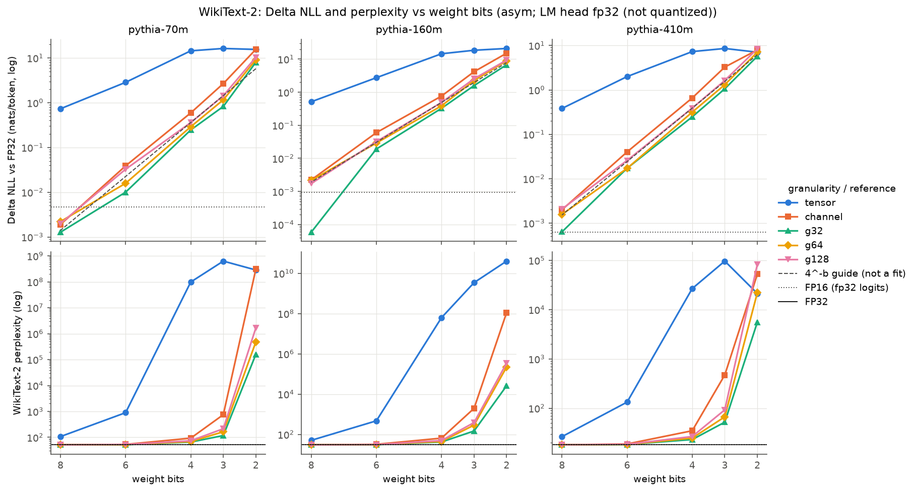
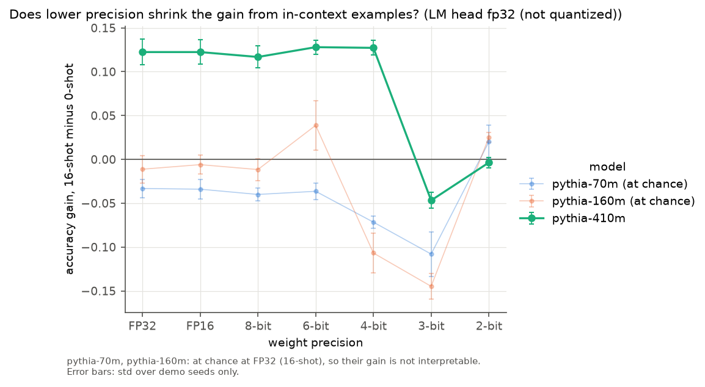
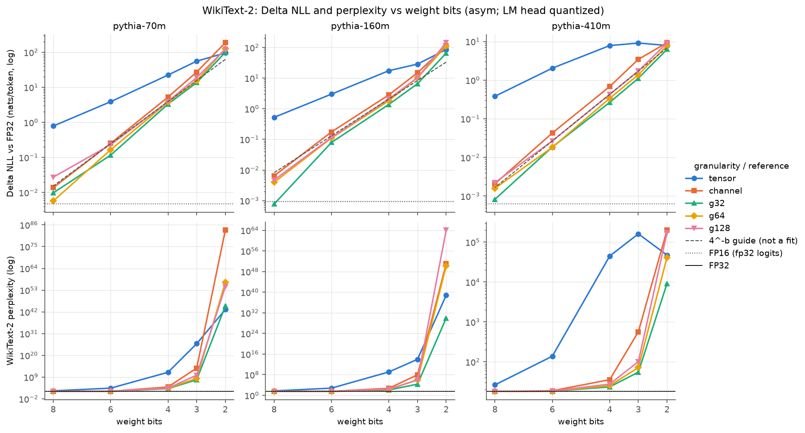
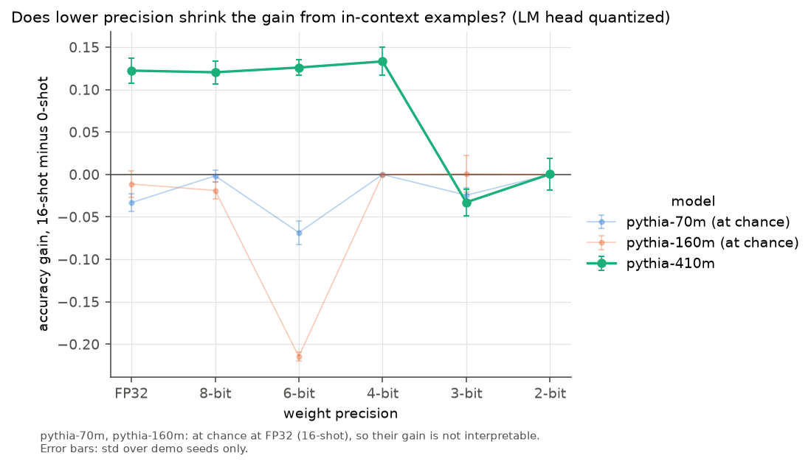
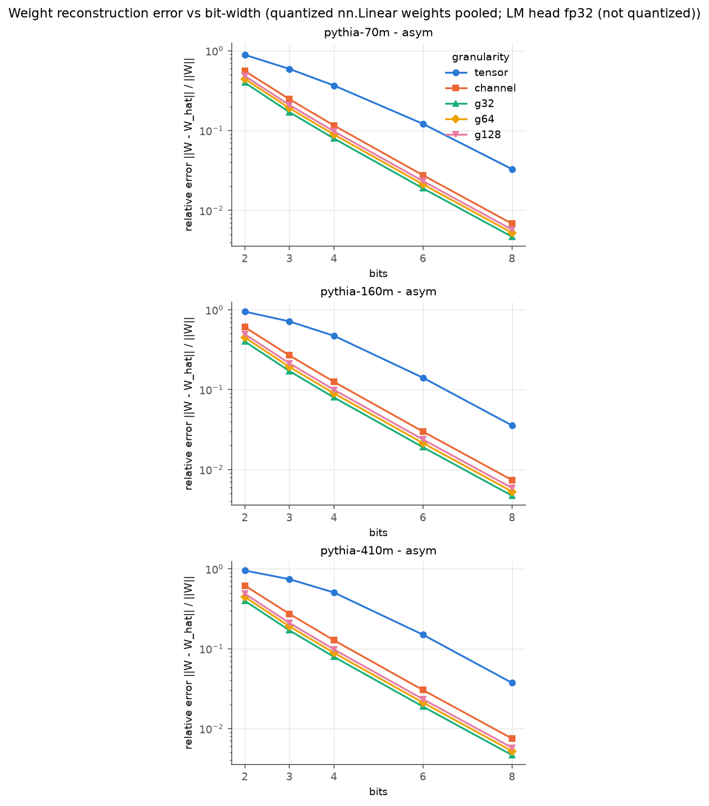
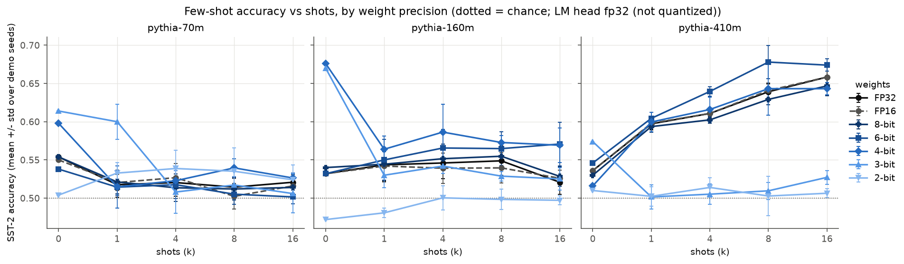
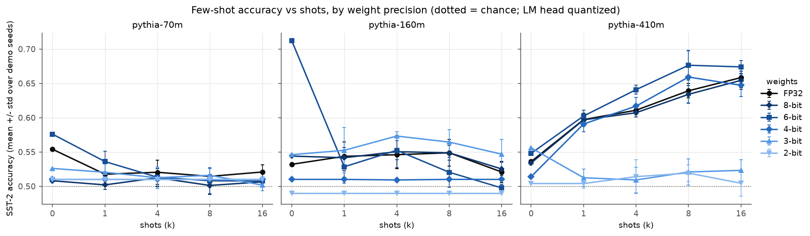

# quantization-toolkit (`qtk`)

From-scratch weight quantizers in PyTorch, plus three experiments on how weight
precision degrades EleutherAI Pythia models (70m / 160m / 410m).

**What this repo measures.** My paper on quantization-induced degradation and
precision-limited in-context learning is a theory paper with no experiments. One
of its predictions concerns how model quality changes as weight-only
quantization lowers the bit-width. This repo measures that relationship on
Pythia under plain round-to-nearest quantization: weight reconstruction error,
WikiText-2 perplexity and the per-token NLL increase over FP32 (ΔNLL), and
few-shot accuracy, at 8, 6, 4, 3 and 2 bits. It reports measurements only. It
does **not** reproduce results from the paper.

**What was measured** (WikiText-2 test set, all 281 chunks; asym g128; LM head
at full precision; `results/ppl.csv`). For pythia-70m, 160m and 410m, ΔNLL
relative to FP32 is about 0.002 nats/token at 8 bits, 0.03 at 6 bits, 0.36–0.49
at 4 bits, 1.4–2.6 at 3 bits and 8.4–10.4 at 2 bits. Between 8 and 3 bits it
multiplies by 3.3–5.2 for each bit removed. In perplexity: pythia-70m goes from
51.4 (FP32) to 51.5, 53.1, 73.7, 215 and 1.7 × 10⁶ at 8, 6, 4, 3 and 2 bits;
pythia-160m from 30.3 to 30.3, 31.3, 49.4, 387 and 3.5 × 10⁵; pythia-410m from
18.0 to 18.1, 18.5, 26.6, 92.7 and 8.3 × 10⁴. Per-tensor scaling is much worse
(ΔNLL 0.38–0.73 already at 8 bits), and g32 is the best granularity at 4, 3
and 2 bits for all three models.

The three experiments:

1. **Reconstruction error** (`qtk error`): how far the fake-quantized weight
   matrices are from the originals, as a function of bit-width and quantization
   granularity.
2. **Perplexity** (`qtk ppl`): WikiText-2 perplexity and ΔNLL at FP32, FP16 and 8/6/4/3/2-bit weights.
3. **In-context learning** (`qtk icl`): SST-2 few-shot accuracy at k = 0, 1, 4, 8, 16
   shots for each precision. *Does lower precision reduce how much the model gains
   from extra shots?*

Each experiment writes a CSV, a PNG and a `*_meta.json` (arguments, library
versions, device, git SHA) to `results/`.

## Setup (Windows 11, PowerShell)

```powershell
py -3.12 -m venv .venv
.\.venv\Scripts\Activate.ps1
python -m pip install --upgrade pip

# GPU: the RTX 50-series (Blackwell, sm_120) needs a PyTorch build for CUDA 12.8 or newer.
pip install torch --index-url https://download.pytorch.org/whl/cu128
# CPU only: pip install torch

pip install -e ".[dev]"

# check the GPU is visible
python -c "import torch; print(torch.__version__, torch.cuda.is_available(), torch.cuda.get_device_name(0) if torch.cuda.is_available() else '')"
```

The results in this repo were produced with Python 3.12.10 and torch
2.11.0+cu128 (CUDA 12.8), as recorded in `results/ppl_meta.json`. Newer Python
versions such as 3.14 may not have a cu128 wheel; if pip finds none, try the
`cu129` or `cu130` index, or stay on Python 3.12. On Linux/macOS, activate with
`source .venv/bin/activate`; everything else is the same.

The first run downloads the models and datasets to the Hugging Face cache
(roughly 1–2 GB for the three models).

## Running

```powershell
pytest                           # unit + offline end-to-end tests (no downloads)
qtk all --quick                  # tiny smoke test of all three experiments -> results/quick/
qtk error                        # Exp 1
qtk ppl                          # Exp 2
qtk icl --seeds "0,1,2,3,4"      # Exp 3 (final run: 5 demo seeds)
```

**PowerShell note:** quote comma-separated lists (`--bits "8,4,2"`). PowerShell
turns an unquoted `8,4,2` into an array and splits it into separate arguments.

Every command takes `--device auto|cpu|cuda` (default `auto`: CUDA if available),
`--out-dir` (default `results`), `--seed` (default 0), `--revision`
(default `step143000`) and `--quantize-head` (also quantize the LM head; see
[The LM head](#the-lm-head)). Run `qtk <command> --help` for all flags.

Quick-run flags for CPU:

| command | flag | effect |
|---|---|---|
| `qtk error` | `--max-layers N` | only the first N `nn.Linear` layers per model |
| `qtk ppl` | `--max-chunks N` | only the first N 1024-token chunks |
| `qtk icl` | `--n-eval N`, `--shots`, `--seeds` | fewer examples / conditions |
| all | `--models`, `--bits` | e.g. `--models pythia-70m --bits "8,2"` |

Examples:

```powershell
qtk ppl --models pythia-70m --bits "8,4,2" --max-chunks 8 --device cpu
qtk icl --models pythia-70m --bits "8,4" --shots "0,4" --seeds 0 --n-eval 64
qtk ppl --scheme sym --granularity channel --out-dir results/sym_channel
qtk ppl --granularity "tensor,channel,group:32,group:64,group:128"   # several granularities in one CSV
qtk ppl --quantize-head --out-dir results/head_quantized              # head-included ablation
```

## Quantizers

Implemented from scratch in [`src/qtk/quant.py`](src/qtk/quant.py), with no
quantization libraries. Any bit-width from 2 to 8 is supported. All quantizer
arithmetic runs in **float32**, whatever the model's dtype.

A weight `W` of shape `[out, in]` is split into groups, each with its own scale:

| granularity | one scale per |
|---|---|
| `tensor` | whole matrix |
| `channel` | output row |
| `group:N` (N = 32, 64, 128, ...) | N contiguous input columns within a row. If `in` is not a multiple of N, the last group is zero-padded; the padding never changes the range. |

| scheme | definition (b bits, round = round-half-to-even) |
|---|---|
| `sym` | `qmax = 2^(b-1) - 1`, `s = max|w| / qmax`, `q = clamp(round(w/s), -qmax, qmax)`, `w_hat = q*s` |
| `asym` | `lo = min(min w, 0)`, `hi = max(max w, 0)`, `s = (hi - lo) / (2^b - 1)`, `z = round(-lo/s)`, `q = clamp(round(w/s) + z, 0, 2^b - 1)`, `w_hat = (q - z)*s` |

Notes:

- `sym` uses the restricted, zero-centred range, so it has `2^b - 1` levels.
  At 2 bits that is {-s, 0, +s}.
- `asym` widens the range to include 0, so zero is always exactly representable.
- A group with zero range (for example, all zeros) gets `s = 1`. No division by
  zero occurs, and an all-zero group round-trips exactly.
- Every element satisfies `|w - w_hat| <= s/2` (tested).

**Fake quantization** ([`src/qtk/model.py`](src/qtk/model.py)): `apply_fake_quant`
replaces the weight of **every `nn.Linear` except the LM head** with
`dequantize(quantize(W))`. For Pythia that is the attention QKV and output
projections and both MLP matrices. The untied LM head (`lm_head` in
transformers 5.x; `embed_out` in older releases) stays at full precision unless
`--quantize-head` is passed, which quantizes every `nn.Linear` including the
head. Biases, LayerNorms and the input embedding (`nn.Embedding`) always stay at
full precision. Each bit-width is quantized from a saved copy of the original
weights, so errors never compound across a sweep, and `restore_weights` puts the
originals back bit-exactly.

Every results CSV has a `head` column: `fp32` when the LM head kept its original
weights, `quantized` when it was fake-quantized. The FP32 and FP16 baseline rows
are always `fp32`. Figure titles say which variant they show.

## Experimental defaults

**Precision.** The **FP32 model is the reference**. Quantized models are
fake-quantized in FP32 *and run in FP32*, so the only difference from the
reference is the quantization itself. An **FP16** run of the unquantized model
is reported as an extra baseline row on CUDA. It is skipped on CPU, where
half-precision kernels are slow and unrepresentative.

**The FP16 row means "FP16 body, FP32 logits".** In every run the LM-head
matmul is done in FP32: the final hidden state and the head weight are cast to
FP32 *before* the matmul, and the log-softmax is FP32 too
(`qmodel.fp32_logits`, used by Exp 2 and Exp 3). For FP32 and quantized runs
those casts are no-ops, so their numbers are bit-for-bit unchanged (tested). For
FP16 it matters: Pythia's logits reach about 1000 in magnitude, where FP16
spacing is 0.5. Earlier, the head ran in FP16 and the logits were rounded to
FP16 before an FP32 log-softmax. That rounding alone cost pythia-70m 3.5%
perplexity (40 chunks: FP32 52.95, FP16 logits 54.94, FP16 body with FP32
logits 53.21); rounding *h* and *W* to FP16 and multiplying in FP32 cost nothing.

**Default quantizer for Exp 2 and 3:** asymmetric, group size 128
(`--scheme asym --granularity group:128`), LM head at full precision. Exp 1
sweeps every combination of {sym, asym} × {tensor, channel, g32, g64, g128} at
2–8 bits.

**Models:** `EleutherAI/pythia-{70m,160m,410m}` at revision `step143000`, the
final training checkpoint (the same weights as `main`), pinned for reproducibility.

**Exp 1 (reconstruction error):**
- Uses the quantized `nn.Linear` weights of pythia-70m and pythia-160m: all of
  them except the LM head by default, the head too with `--quantize-head`.
- Per layer: MSE and relative error `||W - W_hat||_F / ||W||_F`.
- The plot shows the pooled relative error `sqrt(sum ||W - W_hat||^2 / sum ||W||^2)`.
- Outputs `error.csv` (per layer), `error_summary.csv` (also has the mean of per-layer errors) and `error.png`.

**Exp 2 (perplexity):**
- Uses the WikiText-2 raw test split (`Salesforce/wikitext`, `wikitext-2-raw-v1`).
  Lines are joined with `"\n\n"`, tokenized once, and cut into
  **1024-token non-overlapping chunks**; the trailing partial chunk is dropped.
- PPL = exp(mean next-token NLL over all predicted tokens). The first token of
  each chunk has no context and is not scored. The LM-head matmul and the
  log-softmax are computed in FP32 (see Precision above).
- `delta_nll` = NLL(precision) − NLL(FP32) for the same model, in nats per token
  (0 for the FP32 row).
- `--granularity` takes a comma-separated list; the FP32 and FP16 baselines are
  evaluated once per model, then every (granularity, bit-width) pair.
- `--max-chunks N` keeps the first N chunks.
- Outputs `ppl.csv` and `ppl.png`. The figure has two panels per model: ΔNLL vs
  bits on a log axis, and perplexity vs bits. The dashed grey line in the ΔNLL
  panel is a 4^(−b) guide, set to pass through the median ΔNLL at the middle
  plotted bit-width. It shows the slope that a ΔNLL proportional to the squared
  quantization step would have. It is a visual guide, not a fit to the data.
  Points with ΔNLL ≤ 0 (or infinite perplexity) cannot be drawn on a log axis
  and are left out, with a note under the figure.

**Exp 3 (in-context learning, SST-2):**
- **Eval set:** `stanfordnlp/sst2` validation (872 examples). A fixed
  **500-example** subset (`--n-eval`) is chosen with seed `--seed`
  (default 0), stratified by label.
- **Prompt:** `Review: {sentence}\nSentiment: {label}\n\n` repeated k times,
  then `Review: {query}\nSentiment:`.
- **Scoring:** the prediction is whichever of the label words **" negative" /
  " positive"** has the higher summed log-likelihood as the continuation. The
  LM head and log-softmax run in FP32, as in Exp 2. The CSV also reports the
  mean log-likelihood margin of the correct label.
- **Demos** come from the SST-2 train split. Sentences shorter than 5 words are
  excluded, because train contains many short phrase fragments.
  - Each eval example gets one 16-demo sequence per seed, built from
    (negative, positive) pairs in random order within each pair. The k-shot prompt
    uses the first k demos, so every even k is exactly label-balanced, and k = 1
    gets a random label.
  - The demos depend only on (seed, example), so **every precision sees exactly
    the same prompts**, and comparisons across precisions are paired.
- **Seeds:** 3 demo seeds by default (`--seeds "0,1,2"`); use 5 for the final
  run. k = 0 does not depend on the seed, so it is evaluated once and reported
  under each seed.
- **Long prompts:** prompts longer than the context window (2048 tokens) would be
  truncated from the left. The `n_truncated` column counts this; it should be 0
  for SST-2 at k ≤ 16.
- **Outputs:**
  - `icl.csv` (one row per model × precision × k × seed)
  - `icl_summary.csv` (mean ± std over seeds, and `gain` = acc(k) − acc(0))
  - `icl.png` (accuracy vs k)
  - `icl_gain.png` (gain at the largest k vs precision)
  - `--save-preds` also writes per-example log-probs to `icl_predictions.csv`,
    for paired significance tests.

## The LM head

**The default (head at full precision) was chosen after seeing the data.** The
first version of this repo quantized every `nn.Linear`, including the LM head.
A quick pythia-70m run (4 chunks) gave perplexity 2147 at 4 bits (FP32: 45.7). The
quantizer was checked against an independent float64 implementation and is
correct: scales and zero-points match, and every element is within s/2. Layer
ablations put almost all of the damage in the head (pythia-70m, asym g128,
first 40 WikiText-2 chunks):

| quantized layers | 8-bit ppl | 4-bit ppl |
|---|---|---|
| none (FP32) | 52.95 | 52.95 |
| all `nn.Linear` | 54.38 | 2646 |
| all except the LM head | 53.10 | 74.4 |
| LM head only | 54.23 | 1796 |
| attention only (QKV + output) | 53.09 | 66.5 |
| MLP only | 52.96 | 58.1 |

**Why the head is so sensitive.** Its weight error is not unusual: 6% relative
error at 4 bits, the lowest of any layer. Its input is the problem. Pythia's
final hidden states are large (median per-dimension |h| ≈ 17 for pythia-70m,
≈ 10 for pythia-160m), so the logits are large too (up to ≈ 1000 in magnitude,
per-token standard deviation 64–80 across the vocabulary). A small relative
weight error therefore becomes logit noise of several nats. At g128 the RMS
logit error is 2.98 nats at 4 bits and 0.18 at 8 bits for pythia-70m (1.91 and
0.11 for pythia-160m). About 97–98% of it does not depend on the token: it is a
fixed per-vocabulary-entry bias, in effect a scrambled prior over which tokens
are likely.

**A σ²/2 estimate.** If the head adds zero-mean Gaussian noise of standard
deviation σ to every logit, independently across the vocabulary, the expected
NLL increase is about σ²/2 nats per token (the true token's logit is unchanged
on average, while the log-normaliser grows by up to σ²/2). On 8 chunks, at
4-bit g128 with only the head quantized:

| model | σ (nats) | σ²/2 | measured ΔNLL |
|---|---|---|---|
| pythia-70m | 2.98 | 4.4 | 3.5 |
| pythia-160m | 1.91 | 1.8 | 1.55 |

The estimate gets the size right, but it is an approximation, not a model of
the data: the noise is neither Gaussian nor independent across tokens. Since σ
scales with the quantization step, the estimate also implies that ΔNLL from the
head grows by about 4× for each bit removed, so perplexity (its exponential)
falls off sharply.

**The head-included sweep is kept as an ablation.** `--quantize-head` gives the
original behaviour; its results are in `results/head_quantized/`.

Full test set (281 chunks), asym g128, perplexity with the head at full
precision (`results/ppl.csv`) and quantized (`results/head_quantized/ppl.csv`):

| model | head | FP32 | 8-bit | 6-bit | 4-bit | 3-bit | 2-bit |
|---|---|---|---|---|---|---|---|
| pythia-70m | fp32 | 51.39 | 51.50 | 53.10 | 73.7 | 215 | 1.7 × 10⁶ |
| pythia-70m | quantized | 51.39 | 52.82 | 64.71 | 2591 | 9.4 × 10⁹ | 5.4 × 10⁵⁴ |
| pythia-160m | fp32 | 30.28 | 30.34 | 31.27 | 49.4 | 387 | 3.5 × 10⁵ |
| pythia-160m | quantized | 30.28 | 30.43 | 33.97 | 244 | 1.0 × 10⁶ | 1.2 × 10⁶⁴ |
| pythia-410m | fp32 | 18.03 | 18.07 | 18.50 | 26.6 | 92.7 | 8.3 × 10⁴ |
| pythia-410m | quantized | 18.03 | 18.07 | 18.52 | 27.6 | 101 | 1.7 × 10⁵ |

The head matters a great deal for pythia-70m and 160m and very little for
pythia-410m. The hidden-state scale of pythia-410m has not been measured, so
this repo does not explain that difference.

## Reproducibility

- `set_seed` seeds Python, NumPy and PyTorch, and turns on
  `torch.use_deterministic_algorithms` with `CUBLAS_WORKSPACE_CONFIG=:4096:8`.
- It also disables TF32 (`torch.set_float32_matmul_precision("highest")`), so
  FP32 runs really are IEEE float32 on the GPU.
- Quantization is deterministic (round-to-nearest), and evaluation batching is
  deterministic.
- Repeating a run on the same machine and software stack gives byte-identical
  CSVs; this is tested. Results can differ in the last digits between CPU and
  GPU, or across library versions.
- `*_meta.json` records the exact versions and device used. The code and the
  results were committed together, after the runs, so the `git_sha` in the
  meta files may point to the parent commit rather than the one that contains
  the code that produced them.

## Results

All numbers below come from the final GPU run (RTX 5070, CUDA 12.8): asym
scheme, group size 128, WikiText-2 test set (all 281 chunks of 1024 tokens).
The LM head is kept at full precision unless the row says it is quantized; the
head default was chosen after seeing the data (see [The LM head](#the-lm-head)).
Figures: `results/ppl.png`, `results/icl.png`, `results/icl_gain.png`, and the
same files under `results/head_quantized/`.

### Perplexity: ΔNLL vs FP32 (nats per token), g128

From `results/ppl.csv` (head fp32) and `results/head_quantized/ppl.csv` (head
quantized):

| model | head | 8-bit | 6-bit | 4-bit | 3-bit | 2-bit | FP16 |
|---|---|---|---|---|---|---|---|
| pythia-70m | fp32 | 0.0020 | 0.0327 | 0.3606 | 1.432 | 10.40 | 0.0047 |
| pythia-70m | quantized | 0.0274 | 0.2304 | 3.920 | 19.02 | 122.1 | n/a |
| pythia-160m | fp32 | 0.0017 | 0.0321 | 0.4900 | 2.547 | 9.344 | 0.0009 |
| pythia-160m | quantized | 0.0047 | 0.1150 | 2.086 | 10.41 | 144.1 | n/a |
| pythia-410m | fp32 | 0.0021 | 0.0258 | 0.3894 | 1.637 | 8.439 | 0.0006 |
| pythia-410m | quantized | 0.0022 | 0.0267 | 0.4271 | 1.725 | 9.171 | n/a |

FP32 perplexity: 51.39 (70m), 30.28 (160m), 18.03 (410m). FP16 is "FP16 body,
FP32 logits" and never quantizes the head. Perplexity for every granularity is
in the same CSVs.



*One column per model: ΔNLL vs bits (top) over perplexity vs bits (bottom), both
on log axes, one coloured line per granularity. Reference lines: dotted = FP16
(FP32 logits), solid black = FP32 (bottom panels only); the dashed grey line is a
4^(−b) guide, not a fit to the data.*

**Observation across these three models.** Quantizing `lm_head` changes
perplexity a lot on pythia-70m, less on pythia-160m and very little on
pythia-410m. At 4 bits, ΔNLL with the head quantized vs at full precision is
3.92 vs 0.36 (70m), 2.09 vs 0.49 (160m) and 0.43 vs 0.39 (410m). This is an
observation about three models, not a general law. The explanation in
[The LM head](#the-lm-head) (large final hidden states amplify the head's
weight error into logit noise) was measured on pythia-70m and pythia-160m only.

### In-context learning: SST-2, 16 shots, head fp32

From `results/icl_summary.csv`. Accuracy is the mean over 5 demo seeds (± std
over seeds). Gain = 16-shot accuracy minus 0-shot accuracy.

| model | precision | 0-shot acc | 16-shot acc | gain |
|---|---|---|---|---|
| pythia-70m | FP32 | 0.554 | 0.521 ± 0.010 | −0.033 |
| pythia-70m | 8-bit | 0.554 | 0.514 ± 0.008 | −0.040 |
| pythia-70m | 6-bit | 0.538 | 0.502 ± 0.009 | −0.036 |
| pythia-70m | 4-bit | 0.598 | 0.526 ± 0.007 | −0.072 |
| pythia-70m | 3-bit | 0.614 | 0.506 ± 0.025 | −0.108 |
| pythia-70m | 2-bit | 0.504 | 0.524 ± 0.019 | +0.020 |
| pythia-70m | FP16 | 0.550 | 0.516 ± 0.011 | −0.034 |
| pythia-160m | FP32 | 0.532 | 0.521 ± 0.016 | −0.011 |
| pythia-160m | 8-bit | 0.540 | 0.528 ± 0.013 | −0.012 |
| pythia-160m | 6-bit | 0.532 | 0.571 ± 0.028 | +0.039 |
| pythia-160m | 4-bit | 0.676 | 0.569 ± 0.023 | −0.107 |
| pythia-160m | 3-bit | 0.670 | 0.525 ± 0.015 | −0.145 |
| pythia-160m | 2-bit | 0.472 | 0.497 ± 0.006 | +0.025 |
| pythia-160m | FP16 | 0.532 | 0.526 ± 0.011 | −0.006 |
| pythia-410m | FP32 | 0.536 | 0.658 ± 0.015 | +0.122 |
| pythia-410m | 8-bit | 0.530 | 0.647 ± 0.013 | +0.117 |
| pythia-410m | 6-bit | 0.546 | 0.674 ± 0.008 | +0.128 |
| pythia-410m | 4-bit | 0.516 | 0.643 ± 0.008 | +0.127 |
| pythia-410m | 3-bit | 0.574 | 0.527 ± 0.009 | −0.047 |
| pythia-410m | 2-bit | 0.510 | 0.506 ± 0.006 | −0.004 |
| pythia-410m | FP16 | 0.536 | 0.658 ± 0.014 | +0.122 |

What this shows:

- **Only pythia-410m shows in-context learning above chance at FP32**
  (0.536 at 0 shots, 0.658 at 16 shots). pythia-70m and pythia-160m are at or
  near chance at every k, even at FP32, so their gains are not interpretable.
  pythia-70m's FP32 0-shot accuracy (0.554) is slightly above chance. The
  faded-line rule in `icl_gain.png` tests only FP32 16-shot accuracy. The real
  floor is 0.51 (always predicting the majority label), slightly above the 0.50
  line drawn in the plots.
- **The large negative gains in quantized 70m/160m rows** (for example 160m
  4-bit, −0.107) are consistent with a shift in the 0-shot label preference,
  which was not measured directly, not with lost in-context learning: 16-shot
  accuracy stays near chance either way. A constant-label prediction scores
  0.51 on this eval subset, so 160m 4-bit at 0.676 0-shot means the quantized
  model's 0-shot calibration differs from FP32; the cause is not established.
- **pythia-410m:** the differences among FP32, 8, 6 and 4 bits (16-shot
  accuracy 0.643–0.674) are within noise; the binomial standard error of one
  accuracy on 500 examples is about 0.021. The 3-bit drop (to 0.527) is not.
  The gain survives at 4 bits (ΔNLL 0.39) and disappears at 3 bits (ΔNLL 1.64).
- **With the head quantized** (`results/head_quantized/icl_summary.csv`),
  pythia-410m is close to the head-fp32 numbers. pythia-70m and 160m at 4 and 2
  bits give the same label for every example: accuracy is fixed at 0.510 or
  0.490 for every k, with zero spread across seeds.

**`icl_gain.png`** plots the 16-shot gain per precision, one line per model.
pythia-70m and pythia-160m are drawn as thin faded lines, with a note that they
are at chance at FP32 and their gain is not interpretable; pythia-410m is the
full-colour line. (A model counts as at chance when its FP32 16-shot accuracy is
within two binomial standard errors of 0.5.) The error bars show the standard
deviation over the 5 demo seeds only; they leave out sampling error from the
eval subset. The same applies to `results/head_quantized/icl_gain.png`.



*16-shot gain per precision; pythia-70m and pythia-160m (faded) are at or near
chance at FP32, so their gain is not interpretable; error bars are std over demo
seeds only.*

**How much to trust the ICL numbers.** The eval subset is 500 examples (255
positive, 245 negative, so about 51% one label), the same for every seed and
precision. The 5 seeds vary only the demonstrations, not the eval examples, so
the seed standard deviation understates the uncertainty: it leaves out sampling
error from the 500-example subset. No prompt was truncated.

## Figures

<table>
  <tr>
    <th></th>
    <th>LM head fp32 (default)</th>
    <th>LM head quantized</th>
  </tr>
  <tr>
    <td>Perplexity</td>
    <td></td>
    <td></td>
  </tr>
  <tr>
    <td></td>
    <td colspan="2"><em>One column per model, ΔNLL vs bits (top) over perplexity vs bits (bottom), both on log axes, one coloured line per granularity; the dashed grey line is a 4^(−b) guide, not a fit to the data.</em></td>
  </tr>
  <tr>
    <td>ICL gain</td>
    <td></td>
    <td></td>
  </tr>
  <tr>
    <td></td>
    <td colspan="2"><em>pythia-70m and pythia-160m (faded) are at or near chance at FP32, so their gain is not interpretable; error bars are std over demo seeds only.</em></td>
  </tr>
</table>



*Pooled relative error `sqrt(sum ||W - W_hat||^2 / sum ||W||^2)` vs bits, one
line per granularity (LM head not quantized).*

<details>
<summary>More plots</summary>

Accuracy vs number of shots, one panel per model, one line per precision
(dotted = chance), LM head fp32 (default):



LM head quantized:



</details>

## Limitations

- **Fake quantization only.** Weights are quantized then dequantized, which
  measures accuracy loss but gives no memory or speed benefit.
- **Round-to-nearest only.** There are no calibration-based methods (GPTQ, AWQ),
  no outlier handling and no activation quantization. This is deliberate: the
  prediction under test is about plain weight-only rounding.
- **Embeddings, biases, LayerNorms and (by default) the LM head stay full
  precision.** The head-included results come from `--quantize-head`.
- **Small scale.** The models are small (70m–410m), and SST-2 is a simple binary
  task, so absolute few-shot accuracies are modest. The comparison that matters is
  across precisions for the same model.

## Layout

```
src/qtk/quant.py       quantizers (QuantConfig, quantize, dequantize, fake_quant)
src/qtk/model.py       model loading, apply_fake_quant / restore_weights
src/qtk/data.py        WikiText-2 chunks, SST-2 subset and demo sampling
src/qtk/exp_error.py   Exp 1
src/qtk/exp_ppl.py     Exp 2
src/qtk/exp_icl.py     Exp 3 (prompting, label scoring)
src/qtk/plotting.py    figures
src/qtk/cli.py         Typer CLI (qtk)
tests/                 pytest: quantizer properties, model wrapping, ICL scoring, offline CLI runs
```
